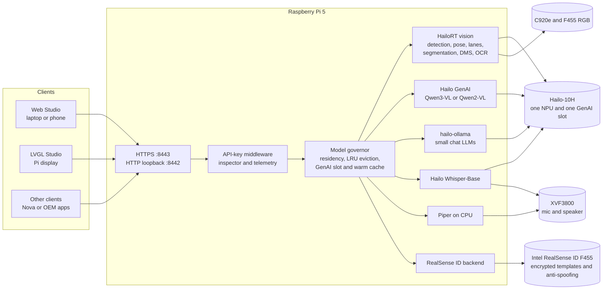
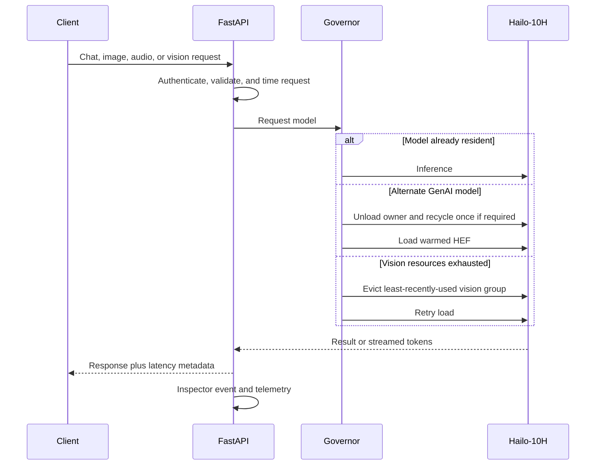

# Hailo AI Box

Edge AI inference server and demo Studio for **Raspberry Pi 5 + Hailo-10H (AI HAT+ 2)**.
It serves chat LLMs, VLMs, computer vision, ASR, TTS, and RealSense ID face authentication over
one FastAPI service. Web Studio runs on LAN laptops/phones; LVGL Studio runs on the Pi display.

## Architecture



The Hailo has **one GenAI KV-cache slot**. Qwen3-VL is the default for chat and image questions,
so the normal demo does not swap models. Alternate Ollama/VLM selections deliberately unload the
current owner, reclaim device RAM, and load the replacement. The inspector shows every swap,
eviction, and NPU recycle.



## Hardware

Required for the complete demo:

- Raspberry Pi 5, 8 GB RAM, 64-bit Raspberry Pi OS, active cooling, and a reliable 5 V/5 A supply.
- Hailo AI HAT+ 2 with Hailo-10H.
- Intel RealSense ID F455: RGB video and `/dev/ttyACM0` serial connection.
- Logitech C920e USB webcam.
- XMOS XVF3800 microphone/speaker.
- Display for LVGL Studio.
- Two blue USB 3 ports for the cameras and `usb_max_current_enable=1` in
  `/boot/firmware/config.txt`.

Optional: Adafruit GPS with `gpsd` (a satellite fix usually requires a windowsill or outdoor view).

## Software and model versions

- Python 3.13 and a venv with system HailoRT packages.
- **HailoRT CLI, PCIe driver, Python package, Hailo firmware, and `hailo-ollama`: 5.3.0**, all
  matching.
- `hailo-ollama` with `qwen3:1.7b`, `qwen2.5:1.5b`, `llama3.2:1b`, and `qwen2:1.5b`.
- Qwen3-VL-2B-Instruct HEF; Qwen2-VL is optional.
- Whisper-Base, YOLOv8m, YOLOv8m pose, YOLOv5m segmentation, UFLD v2 lanes,
  SCRFD, Paddle OCR detection/recognition, and Piper Amy low.
- **RealSense ID SDK 3.6.1** and **F455 OPFW 9.16.1.1**.
- CMake, Ninja, SDL2, EGL/GLES, PortAudio, ffmpeg, V4L2, ALSA, and build tools.
  `scripts/pi_setup.sh` checks and installs the required Debian packages.

## One-stop Pi setup

Clone the repository on the Pi (or `git pull` an existing clone), then run the setup from this
directory:

```bash
git clone https://github.com/Senthi1Kumar/nova-s2s.git ~/nova-s2s   # first time only
cd ~/nova-s2s/edge/hailo-ai-box
scripts/pi_setup.sh
```

The interactive checklist covers system packages, uv/venv, HailoRT and firmware compatibility,
models, RealSense SDK/firmware, USB power, cameras, XVF3800, gpsd, preset videos, LVGL, tests, and an
on-device model check. It asks before system changes and asks for the sudo password once.
A bar on the bottom line shows the current stage, elapsed time, and an upper-bound ETA
(`--no-progress` turns it off). Large downloads resume. Existing installations and Face ID
enrollments are preserved. Each run is logged to `runtime/logs/setup-*.log` (owner-only).

### Install HailoRT 5.3.0 first

Setup verifies, but does not install, the HailoRT runtime. Hailo distributes it only through the
[Developer Zone](https://hailo.ai/developer-zone/) (login required), and the Raspberry Pi apt
repository stops at 5.1.x (`hailo-h10-all`). Install these 5.3.0 packages, then reboot:

- `hailort` (CLI and library), `hailort-pcie-driver` (driver and Hailo-10H firmware), and the
  `hailort` Python wheel for Python 3.13.

Setup requires every component to report 5.3.0: CLI, firmware, the loaded `hailo1x_pci` driver,
and the Python binding. It then installs the rest:

| Component | When missing or not 5.3.0 |
|---|---|
| `hailo-ollama` | Builds Hailo's public `v5.3.0` source into `/usr/local`, about 4 minutes; replaces an older `hailo-gen-ai-model-zoo` package after asking |
| YOLOv8m, pose, YOLOv5m-seg, SCRFD | Downloads Hailo Model Zoo `v5.3.0` Hailo-10H builds |
| UFLD v2 lanes, Paddle OCR det/rec | Downloads Hailo's Hailo-10H resource builds (the same files hailo-apps uses) |
| Whisper-Base, Qwen2-VL, Qwen3-VL | Downloads the GenAI Model Zoo `v5.3.0` builds |
| Ollama chat models | Pulls them through a temporary `hailo-ollama` on port 8001 |

Setup identifies each HEF build by its exact byte size, which differs in every Model Zoo release,
so no network access is needed. A missing file is downloaded. A different build, such as a 5.1 file
from hailo-apps, is replaced after confirmation. The old file is moved to `.aibox-replaced/` in
the same folder. `scripts/pi_setup.sh --check` reports both cases without changing anything.

Before finishing, setup offers to load and run every model on the Hailo-10H by running the hardware
tests (`pytest -m pi`). Stop `run_aibox.sh` first, because the server owns the NPU.

On a Pi with HailoRT 5.3.0, Model Zoo 5.1 builds also run. An A/B test of the two HEF sets against
the same images and prompts produced the following results:

| | 5.1 builds | 5.3.0 builds |
|---|---|---|
| Detection, pose, and segmentation | Same objects (box IoU 0.91–1.00, keypoints within 3–5 px) | Same; only detections near the 0.35 threshold differ |
| `HAILO_RESOURCE_EXHAUSTED` during the live benchmark | 11 | 0 |
| Lanes, first request | 9.2 s | 1.3 s |
| Qwen3-VL question right after lanes | 25 s | 1.9 s |
| Qwen2-VL: shirt text and "glasses?" | "Cavuquet", "?" | "Racquet", "No…" |
| Whisper-Base WER, 50 XVF3800 cabin clips | **47%** | 55% |

Do not mix the two sets. Whisper-Base v5.1.1 together with the v5.3.0 vision HEFs leaves no room for
Qwen3-VL, and it fails to load with `HAILO_RESOURCE_EXHAUSTED`. Whisper-Base is weak on far-field
cabin audio in both builds.

Useful options:

```bash
scripts/pi_setup.sh --check             # read-only audit
scripts/pi_setup.sh --yes --skip-tests  # accept safe installs and builds
scripts/pi_setup.sh --skip-system
scripts/pi_setup.sh --skip-models
scripts/pi_setup.sh --skip-realsense
```

If the F455 firmware differs, supply a **SKU-compatible signed image**:

```bash
scripts/pi_setup.sh --firmware-image /path/to/signed-firmware.bin
```

Older cameras can require staged updates. The script never force-flashes firmware. A USB power
change requires a reboot.

Setup writes non-secret paths to `runtime/setup.env`. The API key is stored separately in `.env`.

## Start and open Studio

```bash
scripts/run_aibox.sh
```

- LAN Web Studio: `https://<pi-ip>:8443` (accept the self-signed development certificate).
- Pi loopback API: `http://127.0.0.1:8442`.
- LVGL starts automatically when `studio_lvgl/build-gpu/aibox_studio` exists.

Cameras are found when a stream starts, so a camera plugged in later also works. The **USB camera**
source uses a Logitech C920e if one is connected, otherwise any other USB webcam (never the
RealSense). To choose one explicitly:

```bash
ls /dev/v4l/by-id/                                    # connected cameras
scripts/run_aibox.sh --camera /dev/video0             # or a /dev/v4l/by-id/... path
scripts/run_aibox.sh --f455 /dev/v4l/by-id/usb-Intel_...-video-index0
```

Cameras, the F455, and the XVF3800 are optional. Without them, setup reports warnings and still
builds everything. Uploads, preset videos, chat, and the image APIs keep working.

To run the server without LVGL, or restart LVGL separately:

```bash
AIBOX_LVGL=0 scripts/run_aibox.sh
studio_lvgl/scripts/run_on_pi.sh gpu --fullscreen --url http://127.0.0.1:8442
```

## LAN API-key authentication

The AI Box serves its APIs to the whole LAN, so the key keeps other devices on the same network
from using the NPU, cameras, and microphone. Setup prints a short note about the key at the end of
each run.

`pi_setup.sh` preserves an existing `edge/hailo-ai-box/.env` or generates a random
`AIBOX_API_KEY` there with owner-only permissions. A newly generated key is displayed once so the
operator can paste it into Web Studio; existing keys are not displayed again. Setup logs are also
owner-only. `run_aibox.sh` loads the same `.env` automatically.

- Static Studio files are reachable so the browser can display the key dialog.
- `/health`, all `/v1/*` HTTP APIs, WebSockets, and inspector streams require the key from LAN clients.
- Pi loopback is exempt so LVGL and local benchmarks work without browser setup.
- In Web Studio, click **Key**, paste the key from the Pi's `.env` using your own editor, and save.
  The browser stores it only in its local storage.
- API clients use `Authorization: Bearer $AIBOX_API_KEY`.

Example from a shell where the key is already exported:

```bash
curl -k -H "Authorization: Bearer $AIBOX_API_KEY" https://<pi-ip>:8443/v1/models
```

To run without LAN authentication for an isolated lab network, leave `AIBOX_API_KEY` empty. This is
not recommended for a shared network.

## Models and runtimes

Every integrated model and the processor it uses:

| Capability | Integrated model(s) | Inference processor and runtime |
|---|---|---|
| Default text and image chat | Qwen3-VL-2B-Instruct | **Hailo-10H NPU**, HailoRT Python GenAI `VLM` in a worker process |
| Optional VLM | Qwen2-VL-2B-Instruct | **Hailo-10H NPU**, same HailoRT `VLM` API |
| Alternate local chat | Qwen3-1.7B, Qwen2.5-1.5B, Llama-3.2-1B, Qwen2-1.5B | **Hailo-10H NPU** through `hailo-ollama`; FastAPI streams its NDJSON responses |
| Object detection | YOLOv8m | **Hailo-10H NPU**, HailoRT `InferModel`; CPU NMS/labels |
| Pose estimation | YOLOv8m pose | **Hailo-10H NPU**, HailoRT `InferModel`; CPU keypoint decoding |
| Instance segmentation | YOLOv5m segmentation | **Hailo-10H NPU** for boxes/mask coefficients; CPU mask decoding and Studio tinting |
| Lane detection | UFLD v2 (`ufld_v2_tu`) | **Hailo-10H NPU**, loaded on demand; CPU lane post-processing |
| Face/preview tracking | SCRFD-10G | **Hailo-10H NPU** for the preview box and five landmarks; CPU smoothing and oval overlay |
| Driver monitoring | SCRFD-10G + YOLOv8m pose + YOLOv8m | **Hailo-10H NPU**; CPU heuristics, not a full iris/gaze tracker |
| OCR | Paddle OCR detection (`ocr_det`) + recognition (`ocr`) | **Hailo-10H NPU** for both stages; CPU DB crop and CTC decoding |
| Speech-to-text | Whisper-Base | **Hailo-10H NPU**, HailoRT Python GenAI `Speech2Text` |
| Text-to-speech | Piper `en_US-amy-low` ONNX | **Pi CPU**, `piper-tts`/ONNX Runtime |
| Face enrollment, verification, anti-spoofing | RealSense ID recognition models inside the F455 | **Intel camera's own silicon**, not Pi CPU and not Hailo NPU; `rsid_py.FaceAuthenticator` runs on the host only for control |

Both Studios draw filled class-colored segmentation masks with labels. LVGL renders the four
highest-confidence masks to bound CPU and memory use.

### Inference APIs used by AI Box

| API/runtime | Used for |
|---|---|
| `hailo_platform.VDevice(group_id="SHARED")`, `create_infer_model()`, `configure()` | Detection, pose, segmentation, lanes, SCRFD, and OCR HEFs |
| `hailo_platform.genai.VLM` | Qwen3-VL and Qwen2-VL text/image prompts, including text-only Nova chat |
| `hailo_platform.genai.Speech2Text` | Whisper-Base transcription for Nova Voice |
| `hailo-ollama` with `HAILO_OLLAMA_VDEVICE_GROUP_ID=SHARED` | Alternate local-chat LLMs through its HTTP `/api/chat` interface |
| `rsid_py.FaceAuthenticator` over `/dev/ttyACM0` | F455 enrollment, user queries/deletion, configuration, and authentication control |
| `piper-tts` on CPU | Nova Voice speech output |

The F455 performs face detection for authentication, encrypted template storage, face matching,
and anti-spoofing internally with `AlgoFlow.All`. No embedding or faceprint is sent to the Pi. The
separate live preview uses SCRFD on the Hailo NPU only to draw the tracking oval; that preview is
not the identity decision. The current setting is `SecurityLevel.Medium`, and genuine `Spoof`
rejections can still occur with glasses, backlighting, movement, or poor framing.

There is one Hailo GenAI KV-cache slot shared by VLM and Ollama models. CV HEFs use shared HailoRT
scheduling and can remain resident beside the active GenAI model when device RAM permits.

## Preset and uploaded videos

Computer Vision supports cameras, road-video presets, and browser uploads. The preset MP4s are
licensed stock clips, so they are **not in the repository** (`data/videos/` is git-ignored). Place
your own road clips on the Pi as:

```text
data/videos/road_1.mp4
data/videos/road_2.mp4
data/videos/road_3.mp4
data/videos/road_4.mp4
```

Setup preserves existing presets and can link missing ones from `~/Downloads/gettyimages*.mp4`.
Videos and uploads are not model inputs at their original resolution: the server decodes and
resizes frames for each model. Lane Detection selects the first road preset when available.
Browser uploads are limited to 200 MB and expire after 24 hours. YouTube downloading is not required.

## Main APIs

| Endpoint | Purpose |
|---|---|
| `GET /health`, `GET /v1/models`, `GET /v1/system/metrics` | Health, registry, telemetry |
| `POST /v1/chat/completions` | OpenAI-shaped streaming chat, optional image parts |
| `POST /v1/vision/detect`, `POST /v1/vision/ask` | CV inference and VLM questions |
| `WS /v1/vision/stream` | Camera/video frames and overlays |
| `GET`, `POST /v1/vision/videos` | Preset list and video upload |
| `POST /v1/audio/transcriptions`, `POST /v1/audio/speech` | Whisper and Piper |
| `WS /v1/voice/stream` | Speech-to-speech turns with cancellation |
| `GET /v1/face/users` | Sensor users plus host name/role roster |
| `POST /v1/face/enroll` | Enroll `{"name":"Driver Name","role":"driver"}` |
| `POST /v1/face/authenticate` | F455 authentication |
| `DELETE /v1/face/users/{user_id}` | Delete one template and roster entry |
| `DELETE /v1/face/users` | Delete all templates and roster entries |
| `GET /v1/inspector`, `GET /v1/inspector/recent` | Live and recent request/governor events |

Driver/passenger enrollment rejects duplicate faces and duplicate name/role pairs. Replacing a driver
requires confirmation. The white tracking oval turns green after successful authentication.

## Verification and live benchmark

```bash
.venv/bin/pytest -q -m 'not pi'
.venv/bin/python scripts/bench_live.py
.venv/bin/python scripts/bench_live.py --swaps
```

Hardware tests are under `tests/*_pi.py`; run them with Ollama available and no other AI Box NPU owner.
The live benchmark checks all six CV tasks, VLM OCR, warm chat, Piper, Whisper round-trip, and
optional model swaps. It writes an optional JSON report with `--output runtime/bench-live.json`.

Representative Pi measurements (fixture-dependent, not a general accuracy benchmark):

| Check | Measured result |
|---|---|
| Detection / pose / segmentation | 26.6 / 51.4 / 148.3 ms inference |
| Lanes / DMS / OCR | 29.4 / 108.0 / 47.8 ms inference |
| OCR accuracy fixture | `RACQUET`, confidence 0.9765 |
| VLM OCR fixture | Correct `RACQUET` answer |
| Warm Qwen3-VL chat TTFT | About 0.63 s |
| Whisper | 4.2 s audio in 0.48 s; benchmark round-trip correct |
| Piper | About 0.23 s for a 2 s reply |
| VLM to Ollama deliberate swap | About 26.6 s; warm Ollama TTFT about 0.39 s |
| Ollama to lanes / lanes to VLM | About 8.7 s each; warm lane inference about 30 ms |

Normal warm paths are fast; alternate GenAI swaps are not. Small models can still give weak answers,
Whisper-Base is not the highest-WER option for every corpus, and DMS heuristics do not provide
certified attention or gaze measurement. Concurrent NPU work can add latency outliers.

## Development without Hailo hardware

```bash
uv run --extra dev pytest -q
AIBOX_FAKE=1 AIBOX_LVGL=0 uv run python -m aibox
```
